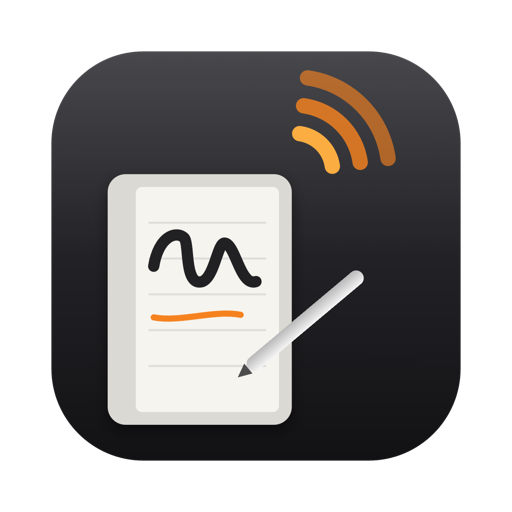
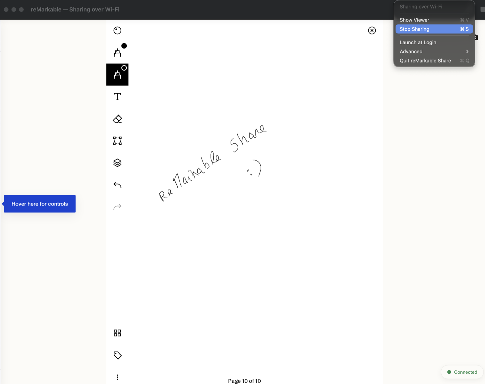

<p align="center"></p>

<h1 align="center">reMarkable Share</h1>

<p align="center">
  Show your reMarkable 2 screen on your Mac, in one click from the menu bar.<br>
  Built by <a href="https://github.com/andreareosa">@andreareosa</a>. Contributions welcome.
</p>

<p align="center"></p>

---

## Why I built this

The official reMarkable desktop app's Screen Share didn't work for me. On my Mac
(macOS 26, reMarkable desktop v3.29 from the Mac App Store), the tablet showed
"Accept connection", but no picture ever appeared on the Mac. The same tablet worked
fine on a friend's computer.

I traced it to the official app never asking macOS for Local Network permission. macOS
blocks it without saying so: the app never appears under System Settings → Privacy &
Security → Local Network, so there's no switch to turn it on. On my managed work Mac I
also couldn't change the setting by hand, and reMarkable offers no Mac download outside
the App Store. So I built my own app that does the job.

If the official Screen Share fails for you the same way, this app should work.

## Features

- **One click to share:** menu bar → Share Screen. The tablet's screen opens in its own
  window, with no browser, login form or certificate warning.
- **USB or Wi-Fi:** share over the cable, or start over USB and then unplug and keep
  going over Wi-Fi.
- **Repairs itself:** if a tablet reset removes the streaming tool, the app downloads it
  again, checks it's the genuine file and reinstalls it.
- **Tidy:** closing the window or quitting the app stops sharing on the tablet.
- **Launch at Login**, plus a `remarkable-share://` URL scheme for Shortcuts, Raycast and
  scripts.

## Requirements

- A **reMarkable 2** (tested on firmware 3.25)
- **macOS 15** or later
- **Xcode**, or the Command Line Tools with Swift 6, to build the app
- The tablet's **USB cable** for first-time setup and for starting each share

## Install

```sh
git clone https://github.com/andreareosa/remarkable-share.git
cd remarkable-share
./scripts/install.sh
```

This builds the app, installs it to `/Applications/reMarkable Share.app` and launches it.
Look for the icon in the menu bar (top-right).

**First run:**

1. Plug in the tablet and wake it up.
2. Click the menu bar icon and choose **Set Up…**.
3. Enter the tablet's root password. You'll find it on the tablet under **Settings →
   Help → Copyrights and licenses → GPLv3 Compliance**.

The app uses that password once to install a dedicated SSH key and never stores it.

## Use

| Action | How |
|---|---|
| Share over USB | Menu bar → **Share Screen (USB)** |
| Share over Wi-Fi | Menu bar → **Share Screen (Wi-Fi)**, then unplug the cable if you want |
| Stop sharing | Close the viewer window, or menu bar → **Stop Sharing** |
| Start with your Mac | Menu bar → **Launch at Login** |
| From Shortcuts, Raycast or Terminal | `open remarkable-share://share/usb`, `.../share/wifi`, `open remarkable-share://stop` |

## How it works

1. The app talks to the tablet over SSH through the USB cable (`10.11.99.1`), using a
   dedicated key (`~/.ssh/remarkable_ed25519`).
2. It starts [goMarkableStream](https://github.com/owulveryck/goMarkableStream) on the
   tablet. If the tool is missing, it downloads a pinned release (`v1.4.0`, RM2 lite),
   checks its SHA-256 and copies it to `/home/root/goMarkableStream`.
3. It logs in for you and shows the stream in a built-in viewer window.

| Mode | Tablet listens on | Transport |
|---|---|---|
| USB (default) | `10.11.99.1:2001` only (the cable) | HTTP over the point-to-point USB link |
| Wi-Fi | all interfaces, port 2001 | HTTPS, trusting only the tablet's certificate (fetched over SSH and pinned) |

Unlike the official app, this one declares `NSLocalNetworkUsageDescription`, so macOS asks
for Local Network permission instead of blocking it silently.

### What's stored where

| What | Where |
|---|---|
| Stream password (random, 20 characters) | Keychain, service `remarkable-share` |
| SSH key | `~/.ssh/remarkable_ed25519` (+ `.pub`) |
| Tablet host key | `~/.ssh/known_hosts_remarkable` |
| Tablet root password | Not stored |

## Troubleshooting

| Problem | Try |
|---|---|
| Menu says "Plug in the tablet's USB cable" | Use a data cable (not charge-only), and wake and unlock the tablet. |
| Viewer window stays blank | Write something on the tablet, or click **Reload** in the window's toolbar. |
| "Tablet isn't on Wi-Fi" | Connect the tablet to Wi-Fi, or share over USB. |
| Wi-Fi sharing won't connect | Make sure the Mac and tablet are on the same network, and that the router doesn't isolate devices (client isolation). |
| Setup says the password was rejected | Check the root password on the tablet again. It changes if you regenerate it or factory-reset the tablet. |

## Uninstall

1. Menu → Advanced → **Remove Streaming Tool from Tablet**.
2. Quit the app and delete `/Applications/reMarkable Share.app`.
3. Optionally delete `~/.ssh/remarkable_ed25519*` and `~/.ssh/known_hosts_remarkable`, and
   remove the `remarkable-share` Keychain item.

## Contributing

Contributions are welcome: [open an issue](https://github.com/andreareosa/remarkable-share/issues) or a pull request. See
[CONTRIBUTING.md](./CONTRIBUTING.md) for the details. In short:

```sh
swift test           # unit tests
./scripts/check.sh   # tests + app build + shellcheck; run before opening a pull request
```

## Credits

- Created and maintained by **André Areosa** ([@andreareosa](https://github.com/andreareosa)).
- Screen streaming is done on the tablet by
  [goMarkableStream](https://github.com/owulveryck/goMarkableStream) by Olivier Wulveryck
  (MIT). This app downloads it, controls it and wraps it in a native Mac experience.

## Disclaimer

This is an independent project. It isn't made, endorsed or supported by reMarkable AS.
"reMarkable" is a trademark of reMarkable AS. goMarkableStream is unofficial software
running on your tablet as root. It lives in `/home` and survives firmware updates, and
the app reinstalls it if a reset removes it. Use at your own risk.

## License

[MIT](./LICENSE) © 2026 André Areosa
